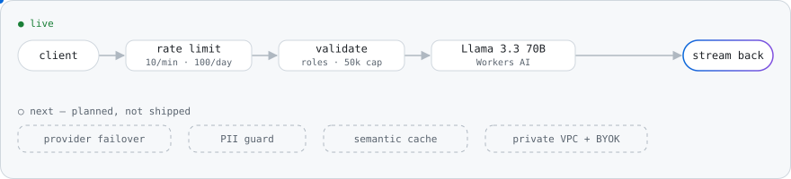

<a href="https://bayar.dev">
  <picture>
    <source media="(prefers-color-scheme: dark)" srcset="./assets/header-dark.svg">
    
  </picture>
</a>

<p align="center">
  <a href="https://bayar.dev"></a>
  <a href="https://bayar.dev/docs"></a>
  <a href="https://www.linkedin.com/in/bayardev"></a>
  <a href="https://x.com/bayardotdev"></a>
  <a href="mailto:hi@bayar.dev"></a>
</p>

I'm **Bayar**, the solo founder of [**bayar.dev**](https://bayar.dev). I build AI infrastructure in public: the layer between your users and the model. The terminal on the homepage is a real streaming endpoint, and every number on the site is measured.

```ts
const bayar = {
  building: "bayar.dev — a live streaming AI terminal, built in public",
  stage:    "early, bootstrapped, shipping",
  shipped:  ["streaming chat on Workers AI", "per-IP rate limiting",
             "request validation", "latency probes every 15 min"],
  now:      "recall: event stream through Kafka into MongoDB Atlas",
  next:     ["provider failover", "PII guard", "semantic cache", "private VPC / BYOK"],
  daily:    "CachyOS + niri (Dux Shell), Rio + zsh, way too many terminals",
  based:    "Walnut Creek, CA",
};
```

### What a request looks like on bayar.dev

<picture>
  <source media="(prefers-color-scheme: dark)" srcset="./assets/flow-dark.svg">
  
</picture>

### Measured, not claimed

<!-- BENCH:START -->
<p>
  <a href="https://bayar.dev/benchmarks">
  
  
  
  
  </a>
</p>

<sub>Llama 3.3 70B (fp8, fast), short chat, last 7 days, probed every 15 minutes. Method and raw data at <a href="https://bayar.dev/benchmarks">bayar.dev/benchmarks</a>.</sub>
<!-- BENCH:END -->

### Latest from the log

<!-- LOG:START -->
- [Why I put a live AI terminal on my homepage](https://bayar.dev/log/why-a-live-terminal-on-my-homepage) · <sub>Oct 11, 2026</sub>
- [Planning the site-public security header rollout](https://bayar.dev/log/making-the-site-public-and-adding-csp) · <sub>Oct 11, 2026</sub>
- [All entries →](https://bayar.dev/log)
<!-- LOG:END -->

### Stack

<p>
  
  
  
  
  
  
  
  
  
</p>

### Public work

| Project | What it is |
| --- | --- |
| [**starfall-arcade**](https://github.com/namchinbayar/starfall-arcade) | A tiny cosmic browser game, deployed with AWS CDK |
| [**@bayardotdev**](https://github.com/bayardotdev) | The bayar.dev organization |

<sub>ORCID <a href="https://orcid.org/0009-0001-5896-7447">0009-0001-5896-7447</a> · commits signed with SSH via 1Password</sub>
