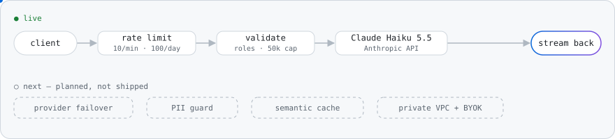

<a href="https://bayar.dev">
  <picture>
    <source media="(prefers-color-scheme: dark)" srcset="./assets/header-dark.svg">
    
  </picture>
</a>

<p align="center">
  <a href="https://bayar.dev"></a>
  <a href="https://bayar.dev/docs"></a>
  <a href="https://www.linkedin.com/in/bayardev"></a>
  <a href="https://x.com/bayardotdev"></a>
  <a href="mailto:hi@bayar.dev"></a>
</p>

I'm **Bayar**, the solo founder of [**bayar.dev**](https://bayar.dev). I build AI infrastructure in public: the layer between your users and the model. The terminal on the homepage is a real streaming endpoint, and every number on the site is measured.

```ts
const bayar = {
  building: "bayar.dev — a live streaming AI terminal, built in public",
  stage:    "early, bootstrapped, shipping",
  shipped:  ["streaming chat on Claude Haiku 5.5", "per-IP rate limiting",
             "request validation", "hourly benchmarks, raw data public",
             "a one-prompt homepage with a tide under it"],
  now:      "recall: knowledge base, Kafka event stream into MongoDB Atlas, metrics, agent + MCP",
  next:     ["provider failover", "PII guard", "semantic cache", "private VPC / BYOK"],
  later:    "founders access: tools for people who support the work",
  daily:    "CachyOS + niri (Dux Shell), WezTerm + zsh, way too many terminals",
  based:    "Walnut Creek, CA",
};
```

### What a request looks like on bayar.dev

<picture>
  <source media="(prefers-color-scheme: dark)" srcset="./assets/flow-dark.svg">
  
</picture>

### Measured, not claimed

<!-- BENCH:START -->
<p>
  <a href="https://bayar.dev/benchmarks">
  
  
  
  
  </a>
</p>

<sub>Claude Haiku 5.5 (low effort), short chat, last 7 days, probed every hour. Method and raw data at <a href="https://bayar.dev/benchmarks">bayar.dev/benchmarks</a>.</sub>
<!-- BENCH:END -->

### Latest from the log

<!-- LOG:START -->
- [The homepage is one prompt now, with a tide under it](https://bayar.dev/log/the-homepage-is-one-prompt-with-a-tide-under-it) · <sub>Nov 14, 2026</sub>
- [What enforcing the CSP cost, and what it could not see](https://bayar.dev/log/what-enforcing-the-csp-cost-and-what-it-could-not-see) · <sub>Nov 14, 2026</sub>
- [The homepage now leads with numbers I measure](https://bayar.dev/log/the-homepage-now-leads-with-numbers-i-measure) · <sub>Nov 14, 2026</sub>
- [All entries →](https://bayar.dev/log)
<!-- LOG:END -->

### Stack

<p>
  
  
  
  
  
  
  
  
  
  
  
  
  
</p>

### Public work

| Project | What it is |
| --- | --- |
| [**recall**](https://bayar.dev/projects#recall) | A personal knowledge base searched by meaning: Voyage embeddings, Atlas vector search, a Kafka event stream, and an MCP server. Private repo |
| [**command-center**](https://bayar.dev/projects#command-center) | A private start page for running bayar.dev, read from Airtable with zero runtime dependencies. Private repo |
| [**tailscale-policy**](https://bayar.dev/projects#tailscale-policy) | My tailnet rules as GitOps: tested on every PR, applied on merge, signed in with GitHub OIDC. Private repo |
| [**starfall-arcade**](https://github.com/namchinbayar/starfall-arcade) | A tiny cosmic browser game: private S3 behind CloudFront, deployed with AWS CDK |
| [**@bayardotdev**](https://github.com/bayardotdev) | The bayar.dev organization |

<sub>ORCID <a href="https://orcid.org/0009-0001-5896-7447">0009-0001-5896-7447</a> · commits signed with SSH via 1Password</sub>
